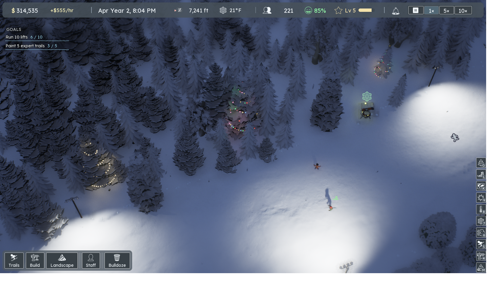

# Festive Slopes 0.1.1

*AverySnookk Studios*. A standalone, cosmetic Christmas mod for **Ski-E-O! Ski Resort Tycoon** (UE4SS Lua).

Festive Slopes dresses the trees your resort already has in Christmas lights, stars and ornaments, and puts gingerbread houses beside some trails. It adds no trees. It picks healthy evergreens from the game's own forest along trail edges and around your buildings, and fits the lights to each tree's real size so they sit on the branches.

## Features

### Dressed trees
- **Lights:** strings of coloured or warm-white glowing bulbs that spiral up each tree, sized to the tree's actual height and canopy.
- **Toppers:** gold stars with a glowing core on the real top of the tree.
- **Extras:** ornaments, and gift boxes on the open side of the tree.

### Where trees are dressed
- Spruce, fir, pine, whitebark pine and hemlock in good health.
- Deciduous, dead and dying trees and krummholz are left alone.
- Along trail edges (trunks never on a trail), and around lodges, huts and shops.

### Gingerbread houses
- Icing trim, a snowy candy roof, gumdrops, candy canes and glowing windows.
- Placed only on open, gentle ground beside a trail. They keep clear of the forest, buildings, lifts, small props, walkways and the skiable area.

### Density
Five levels: **off, light, moderate (default), festive and wonderland**. At least one trail always stays natural.

### Behaviour
- **Stable:** the same resort always gets the same decorations. Placements are cached per resort.
- **Self-updating:** new or changed trails, buildings and lifts, and cleared or planted trees, update the decorations within about 30 seconds. Unchanged areas are not rebuilt.
- **Cosmetic only:** no collision, nothing added to the game's systems, nothing written to your save. Removing the mod leaves your resort exactly as it was.
- **Standalone:** needs only UE4SS. It is independent of other mods.

## Download

Get the newest **`FestiveSlopes-….zip`** from the [Releases page](https://github.com/AverySnookk/FestiveSlopes/releases/latest).

## Install

See [INSTALL.txt](INSTALL.txt). In short, copy `mods\FestiveSlopes` into the game's `mods` folder (UE4SS installed), start the game and load a resort. Decorations start appearing near the camera within about 15 seconds the first time you open a resort, and within about 6 seconds after that (the layout is cached).

## Settings (`mods\FestiveSlopes\Config\FestiveSlopes.ini`)

| Setting | Default | What it does |
|---|---|---|
| `enabled` | true | Master switch |
| `density` | moderate | off, light, moderate, festive, wonderland |
| `tree_frequency` | 1.0 | Multiplier for how many trees get dressed (0–3) |
| `house_frequency` | 1.0 | Multiplier for gingerbread houses (0–3) |
| `max_decorations` | 600 | Hard cap for the whole resort |
| `holiday_lighting` | true | Glowing lights, stars and windows. `false` keeps ornaments only |
| `light_brightness` | 1.0 | Glow strength (0.2–4) |
| `placement_seed` | 0 | 0 follows the resort; any other number gives a different layout |
| `trail_edge_offset_m` | 3 | Where decorating starts outside a trail's edge |
| `max_house_slope_deg` | 18 | Steepest ground for a house |
| `building_clearance_m` / `lift_clearance_m` / `walkway_clearance_m` | 22 / 14 / 5 | Distances houses keep |
| `min_trail_length_m` | 80 | Shorter trails are never decorated |
| `auto_update` / `update_interval_seconds` | true / 30 | Watch the resort for changes |
| `use_cache` | true | Remember placements per resort (`Cache` folder, safe to delete) |
| `keybinds_enabled` | true | Enables the keys below |
| `debug_logging` | false | More detail in the log |

**Keys (in a resort):**
- Ctrl+Alt+F shows or hides the decorations.
- Ctrl+Alt+G regenerates them.
- Ctrl+Alt+J writes a status report to `FestiveSlopes.log`.

**Commands:** UE4SS console `festive <command>`, or one command per line in `mods\FestiveSlopes\commands.txt` (the result is written to `status.txt`).
- `info`, `regen`, `rebuild`, `hide`, `show`
- `clear`, `enable`
- `density <level>`, `trees <n>`, `houses <n>`, `lights on|off`, `seed <n|auto>`
- `goto [tree|house]`, `test`, `diag`, `reload`

## Verified, experimental and not done

Tested in game on build CL8231 with UE4SS 4.0.0, on the Palisades Tahoe ("Boha") resort. Details are in [docs/TEST_RESULTS.md](docs/TEST_RESULTS.md), and the engine findings in [docs/RESEARCH.md](docs/RESEARCH.md).

**Verified in game**
- Dressed real trees (day, dusk and night) and gingerbread houses render correctly.
- Placement stays off trails and away from buildings, lifts and props.
- All five densities. On Palisades Tahoe: light 53 trees, moderate 329 trees and 2 houses, festive and wonderland 593 trees and 7 houses.
- Cache reuse, identical layout on recompute, density changes, hide/show, clear/enable, and map changes without leftovers.

**Experimental**
- How trees are identified (which mesh a tree uses) is worked out at runtime from the game's data and checked against measured tree heights. If the check fails, trees are dressed by measured height alone, which is less precise.
- Only the Palisades Tahoe biome was tested. Other biomes' species (birch, larch and so on) are not dressed.

**Known limitations**
- Gingerbread houses are rare on heavily forested resorts, because they need open, gentle ground beside a trail.
- On larger resorts, festive and wonderland both reach the `max_decorations` cap (600) and look the same. Raise the cap for more.
- Decorating a whole resort takes 15–30 s after it loads (longer at festive and wonderland). The trees nearest the camera are done first. Frame times rise slightly during that time.
- Development crashed the game seven times (all fixed or avoided, see TEST_RESULTS.md). If the game crashes with the mod installed, check `FestiveSlopes.log` and remove the mod's `enabled.txt`.
- Walkways painted by players that the game does not save as walkway runs are not avoided by houses.
- No custom imported 3D assets: all decoration geometry is generated at runtime and uses the game's own materials.
- Multiplayer (Ski-E-O Together) was not tested. Decorations are local, so each player sees their own from the same seed.
- A newer game build can change the data the mod reads. If decorations do not appear, check `FestiveSlopes.log`.

## Uninstall

Delete `mods\FestiveSlopes`, or its `enabled.txt`. Nothing else needs undoing.
